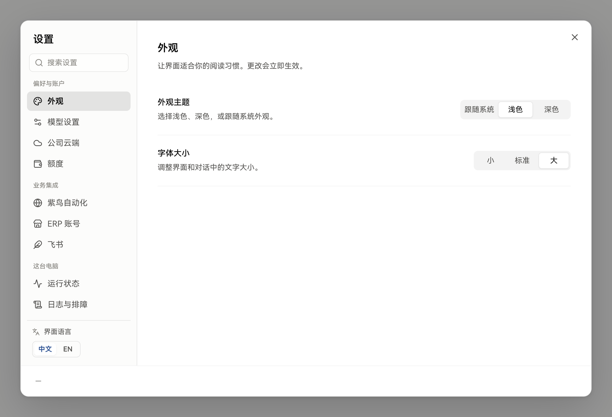
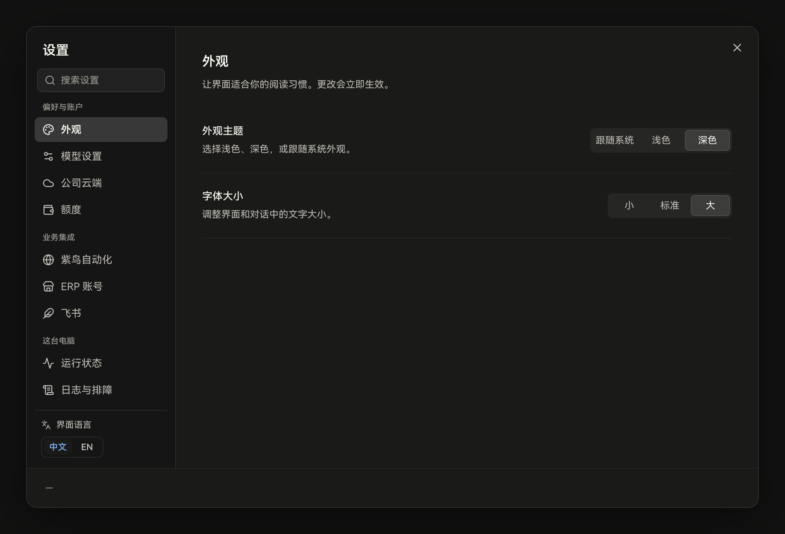
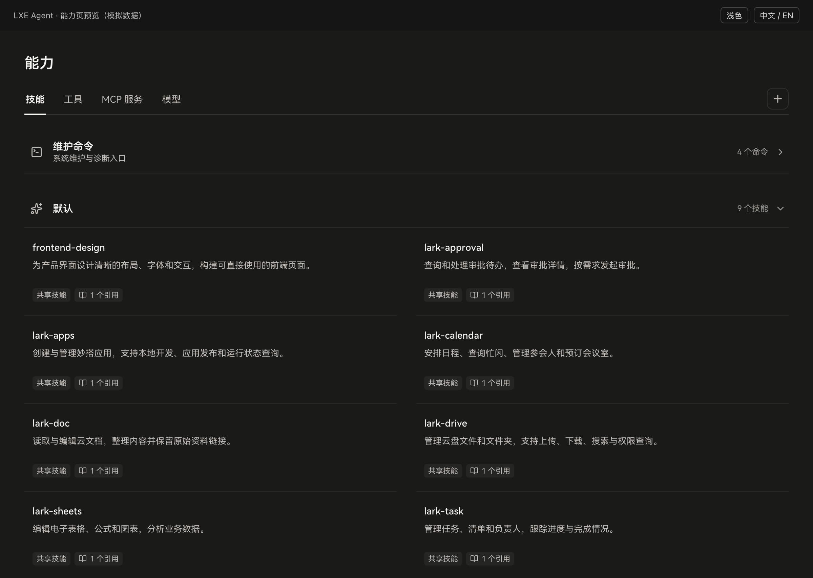
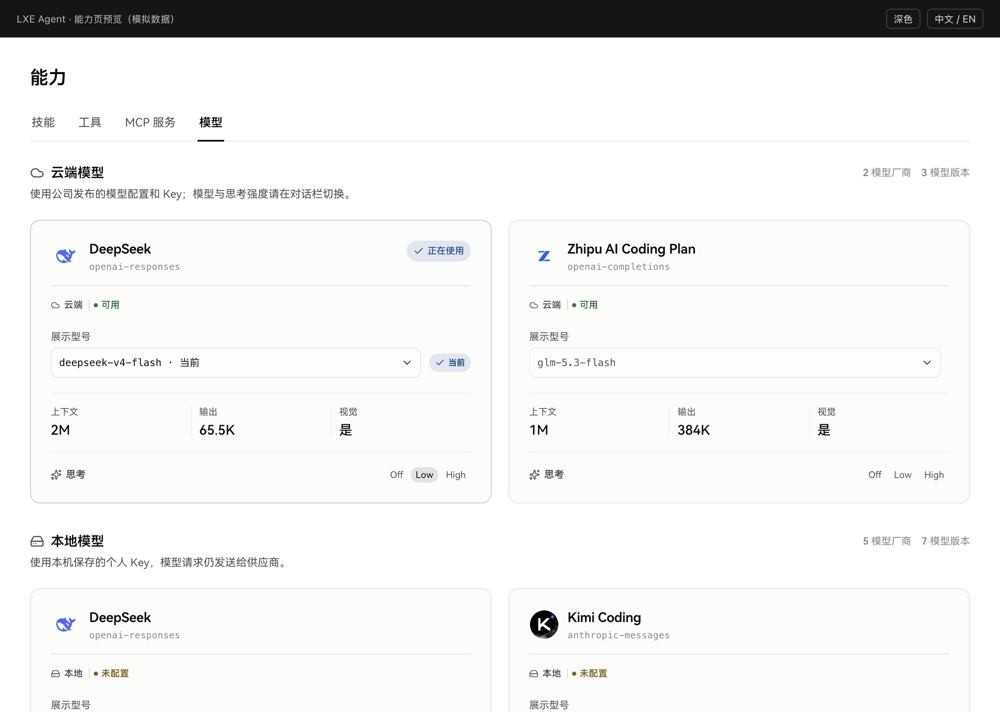

# LXE 落地案例

以下是本次设置页与能力页改版的 **LXE 适配案例**。截图使用本地预览中的示例数据，展示视觉和交互状态；不代表真实账号、服务连接或线上配置，也不是 Claude 官方截图。

本目录保留全部 22 张验证截图。实现提交：设置 `d40cc1b8`；能力页及共享变量 `7e2bef2d`。

2026-10-19 追加：[活动页与工作台](activity-workbench.md)，包含规则对应、适配边界与 8 张新截图。上面的 22 张与历史样式快照保持原样。

2026-10-19 继续追加：[工作台的三个功能页面](workbench-details.md)，包含设置、媒体处理和文件版本管理的规则对应、适配说明与 16 张截图。

2026-10-19 追加：[首页运行概览](home.md)，包含指标、会话、活跃技能的规则对应，以及亮暗、侧栏、窄窗口和数据状态的 8 张截图。

2026-10-19 追加：[对话输入框与文件块配色](conversation-colors.md)，保留原布局，记录语义配色、亮暗交互状态和尺寸核对结果，含 13 张组件截图。

2026-10-19 追加：[对话欢迎页统计卡片](conversation-statistics.md)，沿用中性表面与蓝色热力图，保留指标和网格布局，含 4 张截图。

2026-10-19 追加：[对话侧边栏配色](conversation-sidebar.md)，保留会话列表布局，统一导航表面、文字层次和交互状态，含 6 张截图。

## 设置页

观察点：连续内容面、轻导航选中、文字分级、分段控件、固定保存区域。左导航宽度和表单结构属于 LXE 的布局决定。

| 页面或状态 | 亮色 | 暗色 |
| --- | --- | --- |
| 外观 | [截图](settings/appearance-light.png) | [截图](settings/appearance-dark.png) |
| 模型配置 | [截图](settings/models-light.png) | [截图](settings/models-dark.png) |
| ERP | [截图](settings/erp-light.png) | [截图](settings/erp-dark.png) |
| 状态 | [截图](settings/status-light.png) | [截图](settings/status-dark.png) |
| 键盘焦点 | [截图](settings/focus-light.png) | 未单独存图 |

源码：[设置页样式](../../../../apps/dashboard/src/desktop/settings-theme.css)、[设置页结构](../../../../apps/dashboard/src/desktop/shell.tsx)；[样式快照](styles/settings-theme.snapshot.css)。

## 能力页

观察点：技能／工具从嵌套卡片变为目录行；MCP 状态只占小面积；模型保留品牌 Logo、选择器和参数，背景回归中性。目录列数、标签形式和模型布局属于 LXE 适配。

| 页面 | 亮色 | 暗色 |
| --- | --- | --- |
| 技能 | [截图](capabilities/skills-light.png) | [截图](capabilities/skills-dark.png) |
| 工具 | [截图](capabilities/tools-light.png) | [截图](capabilities/tools-dark.png) |
| MCP 服务 | [截图](capabilities/connections-light.png) | [截图](capabilities/connections-dark.png) |
| 模型 | [截图](capabilities/models-light.png) | [截图](capabilities/models-dark.png) |
| 技能详情 | [截图](capabilities/skills-detail-light.png) | [截图](capabilities/skills-detail-dark.png) |
| 工具详情 | [截图](capabilities/tools-detail-light.png) | [截图](capabilities/tools-detail-dark.png) |
| 用户技能详情 | [截图](capabilities/user-skill-detail-light.png) | 未单独存图 |

源码：[能力页样式](../../../../apps/dashboard/src/features/capabilities/theme.css)、[能力页入口](../../../../apps/dashboard/src/features/capabilities/CapabilitiesPage.tsx)、[详情入口](../../../../apps/dashboard/src/features/details/view.tsx)；[样式快照](styles/capabilities-theme.snapshot.css)。

## 如何复用案例

配色从[共享主题源码](../../../../apps/dashboard/src/shared/cds-theme.css)引用；设计意图看[适配说明](../lxe-adaptation.md)。不要只凭截图重新吸色，也不要把保存的样式快照当作另一份生产主题。

截图能证明当时渲染出来的样子，不能单独证明保存、删除、连接服务等行为正常；那些行为需要各自的测试。亮暗截图也不能代替对比度审计、读屏验证或每一种窗口尺寸的检查。
